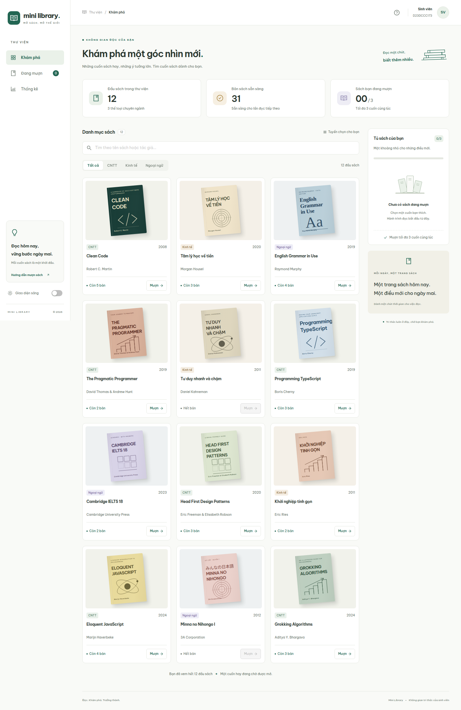

# Mini Library

Ứng dụng tra cứu và mượn/trả sách chuyên ngành cho sinh viên, xây dựng bằng **Vite, React, TypeScript và Ant Design**.

Mã sinh viên: **D23DCCC173** · Môn: **Lập trình Web nâng cao** · Bài kiểm tra giữa kỳ.



## Chạy dự án

Yêu cầu **Node.js 22.12 trở lên** và npm.

```bash
npm ci
npm run dev
```

Mở địa chỉ Vite in trong terminal, mặc định `http://localhost:5173`.

```bash
npm test                # Jest + React Testing Library, chạy một lần rồi thoát
npm run test:coverage   # Báo cáo coverage trong coverage/
npm run typecheck      # Kiểm tra TypeScript strict
npm run build          # Kiểm tra kiểu và build production vào dist/
npm run preview        # Xem bản build
npm run format:check   # Kiểm tra định dạng mã nguồn
```

Kiểm thử trên trình duyệt và tạo ảnh giao diện:

```bash
npx playwright install chromium
npm run test:e2e
```

Playwright tự mở Vite tại cổng 4173 và đóng server khi kết thúc. Nếu máy đã có Chrome tại `/opt/google/chrome/chrome`, cấu hình sử dụng trình duyệt đó; có thể chỉ định trình duyệt khác bằng `CHROME_EXECUTABLE_PATH`.

## Tính năng

- API giả lập chờ **500 ms**, có trạng thái tải, lỗi và nút thử lại.
- Tra cứu tên sách hoặc tác giả không phân biệt hoa thường, hỗ trợ tiếng Việt không dấu và Unicode, **debounce 300 ms**; kết hợp lọc thể loại.
- Danh mục phân trang **12 đầu sách/trang** để giữ số thẻ hiển thị ổn định khi dữ liệu có vài trăm đầu sách; đổi bộ lọc sẽ trở về trang đầu.
- Ba thể loại: **CNTT, Kinh tế, Ngoại ngữ**. Dữ liệu mẫu gồm 12 đầu sách, có cả sách hết bản.
- Mượn/trả cập nhật ngay số bản còn lại và tủ sách cá nhân.
- **Middleware Redux tự viết** chặn cuốn thứ tư và phát cảnh báo; không chỉ dựa vào việc vô hiệu hóa nút trên giao diện.
- Được mượn nhiều bản của cùng một đầu sách. Giới hạn tính theo **tổng số cuốn**, không phải số đầu sách khác nhau. Mỗi thao tác trả hoàn lại một cuốn.
- Theme sáng/tối, nhớ lựa chọn bằng localStorage; bố cục responsive và menu trên điện thoại.
- Trang thống kê có biểu đồ, bảng chi tiết và tổng số sách sinh viên đang mượn.
- Màn hình phục hồi nếu trang hoặc module lazy load bị lỗi; điều hướng thư viện vẫn sử dụng được.

| Đường dẫn      | Nội dung                                                 |
| -------------- | -------------------------------------------------------- |
| `/`            | Danh mục sách, tra cứu, bộ lọc, tủ sách cá nhân          |
| `/borrowed`    | Sách đang mượn và thao tác trả                           |
| `/stats`       | Thống kê, được lazy load                                 |
| `/?apiError=1` | Mô phỏng API thất bại; bấm **Thử lại** để tải thành công |

**Phạm vi dữ liệu:** không cần backend hoặc tài khoản đăng nhập. Redux giữ sách và các khoản mượn trong bộ nhớ của phiên hiện tại; tải lại trang sẽ khởi tạo lại dữ liệu. Chỉ theme được lưu qua lần tải trang. Số bản không sẵn sàng ban đầu có thể là các bản đang được người khác mượn.

## Đối chiếu yêu cầu kỹ thuật

| Yêu cầu                                                   | Vị trí triển khai                                                                         |
| --------------------------------------------------------- | ----------------------------------------------------------------------------------------- |
| Type đầy đủ, không dùng `any`                             | `src/features/books/types.ts` và các kiểu props/state                                     |
| API generic `{ ok: true, data }` / `{ ok: false, error }` | `src/api/types.ts`                                                                        |
| Type guard `isApiSuccess<T>`                              | `src/api/types.ts`, dùng trong thunk                                                      |
| Utility Types                                             | `Extract` trong type guard; `Readonly` cho props; `Record` cho ánh xạ thể loại, tên trang |
| API Promise + setTimeout 500 ms + tham số gây lỗi         | `src/api/booksApi.ts` → `fetchBooksApi(shouldFail)`                                       |
| Redux Toolkit, createSlice                                | `src/features/books/booksSlice.ts`                                                        |
| createAsyncThunk, pending/fulfilled/rejected              | `fetchBooks`, dùng `rejectWithValue` cho phản hồi `ok: false`                             |
| Typed hooks                                               | `src/app/hooks.ts` → `useAppDispatch`, `useAppSelector`                                   |
| Feature-based structure                                   | `src/features/books/`                                                                     |
| Middleware giới hạn 3 cuốn                                | `src/app/middleware/borrowLimitMiddleware.ts`, đăng ký trong `store.ts`                   |
| Zustand quản lý từ khóa và thể loại                       | `src/stores/filterStore.ts`                                                               |
| Theme Context, useMemo cho value, useTheme                | `src/contexts/ThemeContext.tsx`                                                           |
| Custom hook generic useDebounce<T>                        | `src/hooks/useDebounce.ts`                                                                |
| useMemo tính danh sách lọc                                | `src/pages/LibraryPage.tsx`                                                               |
| React.memo cho component sách                             | `src/features/books/components/BookCard.tsx`                                              |
| useCallback cho handler truyền xuống                      | `src/features/books/components/BookList.tsx`                                              |
| Key theo ID                                               | Danh sách dùng `book.id`, các khoản mượn dùng `bookId`                                    |
| React.lazy + Suspense cho /stats                          | `src/App.tsx`                                                                             |
| Jest + RTL + userEvent + fake timers                      | Các file `*.test.ts` và `*.test.tsx` trong `src/`                                         |

## Cấu trúc

```text
src/
├── api/                     # API giả lập, kiểu generic và type guard
├── app/                     # Redux store, typed hooks và middleware
├── components/              # Khung ứng dụng, trạng thái tải/lỗi, thẻ tổng quan
├── contexts/                # ThemeProvider và useTheme
├── features/books/          # Model, slice, UI sách và test nghiệp vụ
├── hooks/                   # useDebounce<T> và test
├── pages/                   # Danh mục, sách đang mượn, thống kê
├── stores/                  # Zustand filter store
├── styles/                  # Token, layout, component và responsive CSS
└── test/                    # Thiết lập Jest/jsdom
e2e/                         # Kiểm thử Chrome bằng Playwright
docs/screenshots/            # Ảnh giao diện chụp từ trình duyệt
```

Luồng mượn sách:

```text
BookCard → dispatch(borrowBook(id))
    → borrowLimitMiddleware
        → Đã đủ 3 cuốn: dispatch cảnh báo, dừng action
        → Còn hạn mức: next(action)
            → booksSlice cập nhật tồn kho + sách đang mượn
                → UI và thống kê nhận state mới
```

Reducer bảo vệ trường hợp hết bản, ID không tồn tại, trả sách chưa mượn và không để số bản vượt tồn kho. Thunk ngăn yêu cầu trùng khi đang tải hoặc đã tải thành công, bao gồm trường hợp StrictMode chạy lại effect.

## Kiểm thử và ảnh giao diện

Chi tiết các kịch bản và quy trình rà soát: [docs/TESTING.md](docs/TESTING.md).

Đánh giá kiến trúc, tối ưu và giới hạn khi đưa vào sử dụng thực tế: [docs/ARCHITECTURE_REVIEW.md](docs/ARCHITECTURE_REVIEW.md).

Ảnh: [desktop sáng](docs/screenshots/desktop-light.png), [desktop tối](docs/screenshots/desktop-dark.png), [đang mượn](docs/screenshots/desktop-borrowed.png), [thống kê](docs/screenshots/statistics.png), [điện thoại](docs/screenshots/mobile-light.png), [tablet](docs/screenshots/tablet-light.png).

Giao diện dùng Ant Design cho Menu, Drawer, Input, Segmented, Card, Button, Tag, Avatar, Badge, Switch, Progress, Table, Modal, Alert, Result, Empty và Skeleton. Font tiếng Việt được đóng gói cùng ứng dụng; bìa sách dùng SVG/CSS, không phụ thuộc ảnh hoặc font từ dịch vụ bên ngoài.

## Trước khi nộp

- Tạo repository GitHub **public** tên `D23DCCC173_LTWNC_GiuaKy`.
- Đẩy mã nguồn, `package-lock.json`, tài liệu và ảnh; không đưa `node_modules`, `dist`, `coverage` lên repo.
- Chạy `npm test` và `npm run build` trên bản cuối cùng.
- Kiểm tra thời điểm commit cuối theo hạn giảng viên quy định; cho phép nộp trễ không thay thế điều kiện về giờ commit.
- Đối chiếu quy định làm bài cá nhân và sử dụng công cụ của học phần.

Thuộc tính `private: true` trong `package.json` chỉ ngăn xuất bản package lên npm, không quyết định chế độ public/private của repository GitHub.
